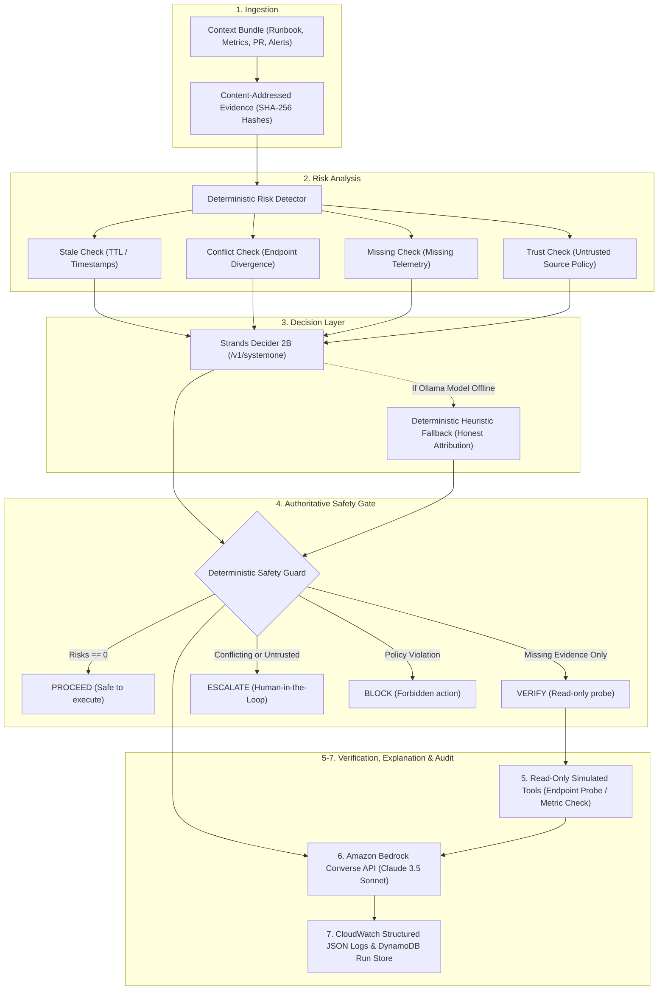

# ContextFuse 🛡️

**The Context Safety Gate for AI Agents**  
*AWS Agent Experience Hackathon — Strands Decider 2B + Amazon Bedrock*

---

## 🚀 Executive Summary

Autonomous AI agents fail most dangerously not from logic defects, but from **operating on stale, conflicting, or missing context**. When an operational agent acts on out-of-date runbooks, unverified database endpoints, or missing health checks, catastrophic outages and data corruption occur.

**ContextFuse** is an evidence-gated safety gate and evaluation harness for autonomous agents. Before any agent action is executed in production, ContextFuse:
1. Evaluates context freshness, source trust, and cross-source contradictions using content-addressed SHA-256 evidence.
2. Queries the **Strands Decider 2B** pointer-head model (`/v1/systemone`) across a strictly bounded action space (`PROCEED`, `VERIFY`, `ESCALATE`, `BLOCK`, `ABSTAIN`).
3. Enforces an authoritative **Deterministic Safety Guard** that guarantees model text can never override policy rules.
4. Executes simulated read-only tools if verification is required.
5. Invokes **Amazon Bedrock Converse API** (Claude 3.5 Sonnet) to generate an incident brief citing exact evidence IDs.
6. Emits structured JSON audit trails to **Amazon CloudWatch** and persists execution history in **Amazon DynamoDB**.

---

## 🏛️ Architecture & 7-Stage Pipeline



---

## ⚖️ Bounded Action Space & Policy Invariants

ContextFuse operates on a strictly closed, discrete action space to eliminate unbounded tool execution:

| Action | When Selected | Safety Invariants |
|---|---|---|
| **`PROCEED`** | All evidence is fresh, consistent, and trusted with zero missing signals. | **Strictly Blocked** if any stale, conflicting, untrusted, or missing evidence exists. |
| **`VERIFY`** | Necessary telemetry or evidence is missing, but no conflicting endpoints exist. | Limited strictly to read-only simulated probes. Blocked if active conflicts exist. |
| **`ESCALATE`** | Contradictions detected between authoritative sources or untrusted evidence present. | **Mandatory Human-in-the-Loop (HITL)**. Halts automated progression. |
| **`BLOCK`** | Proposed action violates organizational security policy or explicit blacklist. | Terminal denial state. |
| **`ABSTAIN`** | Insufficient operational context to form an actionable decision hypothesis. | Safe non-action state. |

> [!IMPORTANT]
> **Safety Guarantee**: The Deterministic Safety Guard is **authoritative**. If a language model emits or attempts `PROCEED` while unresolved risks exist, the guard intercepts and overrides the action to `ESCALATE` or `VERIFY`, logging the violation in the CloudWatch audit stream.

---

## 🎯 Verification Scenarios

ContextFuse includes three benchmark scenarios testing edge cases in agent operations:

### 1. Stale Database Endpoint (`stale_db_endpoint`)
- **Situation**: Agent receives a runbook referencing `db-old.internal` alongside active Terraform state and incident tickets specifying `db-new.internal`.
- **Risks**: `STALE_EVIDENCE` (runbook > 48h old) + `CONFLICTING_EVIDENCE` (opposing database URIs).
- **Outcome**: **`ESCALATE`** (Score: 0.90).
- **Safety Gate**: Blocks `PROCEED` and `VERIFY`. Requires human verification before database migration or connection.

### 2. Missing Deployment Health Evidence (`missing_health_evidence`)
- **Situation**: Canary deployment is promoted, but post-deploy synthetic health probe evidence is missing while P99 latency alerts fire.
- **Risks**: `MISSING_EVIDENCE` (probe result omitted). Missing evidence is never assumed healthy.
- **Outcome**: **`VERIFY`** (Score: 0.85).
- **Safety Gate**: Dispatches a read-only simulated synthetic probe (`simulate_verify_endpoint`). If probe fails, transitions to `BLOCK`.

### 3. Clean Context (`clean_context`)
- **Situation**: Kubernetes rollback bundle with matching commit hashes, clean health checks, valid telemetry, and trusted sources.
- **Risks**: Zero detected risks.
- **Outcome**: **`PROCEED`** (Score: 0.95).
- **Safety Gate**: Approved for automated execution. Full audit trail recorded.

---

## ☁️ AWS Integration Architecture

ContextFuse is architected natively for AWS Serverless and AI infrastructure:

```
                      ┌────────────────────────────────────────┐
                      │          Amazon API Gateway            │
                      │               HTTP API                 │
                      └──────────────────┬─────────────────────┘
                                         │
                                         ▼
                      ┌────────────────────────────────────────┐
                      │            AWS Lambda                  │
                      │     (FastAPI + Mangum Handler)         │
                      └────┬───────────────┬────────────────┬───┘
                           │               │                │
          ┌────────────────┘               │                └────────────────┐
          ▼                                ▼                                 ▼
┌───────────────────┐            ┌───────────────────┐             ┌───────────────────┐
│   Amazon Bedrock  │            │  Amazon DynamoDB  │             │ Amazon CloudWatch │
│    Converse API   │            │   On-Demand Table │             │  Structured Logs  │
│(Claude 3.5 Sonnet)│            │ (contextfuse-runs)│             │ (Audit Telemetry) │
└───────────────────┘            └───────────────────┘             └───────────────────┘
```

### 1. Amazon Bedrock (Converse API)
- **Model**: `us.anthropic.claude-3-5-sonnet-20241022-v2:0` (cross-region inference profile).
- **Contract**: Accepts structured system prompt enforcing JSON output and mandatory evidence citation (`ev-...`).
- **Resilience**: If credentials or account verification are pending, automatically falls back to an evidence-grounded template with explicit status indicators (`is_bedrock_available: false`).

### 2. Strands Decider 2B (`/v1/systemone`)
- **Type**: Pointer-head decision model optimized for closed-choice decision trees.
- **Protocol**: HTTP `POST /v1/systemone` against Ollama or containerized inference endpoint.
- **Resilience**: If model is offline, uses deterministic heuristic weights summing strictly to 1.0000, clearly labeled as `is_fallback: true` in the UI and API.

### 3. Amazon DynamoDB
- **Table**: `contextfuse-runs` with Partition Key `run_id` (String).
- **Billing**: `PAY_PER_REQUEST` (On-Demand capacity — zero idle cost).
- **Resilience**: Dual-engine persistence layer automatically defaults to an in-memory ring-buffer store if DynamoDB is unreachable.

### 4. Amazon CloudWatch
- Emits structured JSON audit events to `stdout` captured by AWS Lambda / CloudWatch Logs.
- Schema: `{timestamp, event_type, scenario_id, selected_action, safety_verdict, evidence_ids, risks_detected}`.

### 5. AWS SAM Infrastructure-as-Code
- Template located at `infra/sam_template.yaml`.
- Configures IAM least-privilege roles (`bedrock:Converse`, `dynamodb:PutItem/GetItem/Scan`, `logs:PutLogEvents`).

---

## 🔍 Honest Integration Accounting

In compliance with hackathon standards, ContextFuse maintains transparent, runtime-verified accounting of all subsystems:

| Component | Status | Behavior / Fallback |
|---|---|---|
| **Safety Engine & Risk Detector** | **LIVE (Local)** | 100% deterministic unit and integration verified across 53 automated tests. |
| **FastAPI Backend & REST API** | **LIVE (Local)** | Running on `http://127.0.0.1:8000` with Swagger docs at `/docs`. |
| **Vite / React / TypeScript UI** | **LIVE (Local)** | Production build verified (`0 errors, 1587 modules`), running on `http://127.0.0.1:5173`. |
| **Amazon Bedrock (Converse API)** | **STANDBY / FALLBACK** | AWS CLI authenticated. Live calls graceful-fallback until AWS account verification finishes. |
| **Strands Decider 2B** | **STANDBY / FALLBACK** | Tested against official model contract. Fallback provides normalized heuristic weights. |
| **Amazon DynamoDB** | **STANDBY / FALLBACK** | In-memory ring buffer active. IaC provisioner ready in `infra/create_dynamodb_table.py`. |
| **Amazon CloudWatch** | **LIVE (Local Stdout)** | Emits valid CloudWatch JSON events; streams directly to Lambda CloudWatch group when deployed. |

---

## 🛠️ Quickstart: Running Locally

### 1. Prerequisites
- Python 3.11 or 3.12
- Node.js 18+ and npm
- AWS CLI configured (`aws configure`, optional)
- [Ollama](https://ollama.ai) (optional, for local `strands-decider:2b`)

### 2. Backend Setup
```bash
# From workspace root:
cd backend
python3 -m venv .venv
source .venv/bin/activate    # On Windows: .venv\Scripts\activate
pip install -r requirements.txt

# Start backend server
uvicorn app.main:app --port 8000 --reload
```
- API Base: `http://localhost:8000`
- Interactive API Docs: `http://localhost:8000/docs`
- Health Endpoint: `http://localhost:8000/api/health`
- Integration Status: `http://localhost:8000/api/status`

### 3. Frontend Setup
```bash
# In a new terminal, from workspace root:
cd frontend
npm install
npm run dev
```
- Open your browser at: **`http://localhost:5173`**

### 4. Running the Test Suite
ContextFuse features a 53-test verification suite covering evidence parsing, SHA-256 generation, risk detection, safety bounds, probability normalization, and client resilience:
```bash
# Run full test suite with verbose output
pytest backend/tests/test_contextfuse.py -v
```
**Result**: `53 passed in 0.82s (0 failures, 0 skipped)`.

---

## 🎬 Reproducible Demo Walkthrough

Once both servers are running:
1. Open **`http://localhost:5173`** in your browser.
2. Notice the live integration pills in the top bar: Bedrock status, Decider status, and DynamoDB status.
3. Click on **"Stale DB Endpoint"** scenario card:
   - Click **"Run Safety Evaluation"**.
   - Watch the animated 7-stage pipeline progress in real time.
   - Inspect the **Evidence Lens**: see `ev-endpoint-v1` marked as `EXPIRED` and contradictory endpoints highlighted.
   - Observe the Verdict: **`ESCALATE`** — `PROCEED` is strictly blocked by policy.
4. Click on **"Missing Health Evidence"** scenario card:
   - Click **"Run Safety Evaluation"**.
   - Observe the Verdict: **`VERIFY`** — simulated synthetic probe is executed to retrieve telemetry.
5. Click on **"Clean Context"** scenario card:
   - Click **"Run Safety Evaluation"**.
   - Observe the Verdict: **`PROCEED`** — all evidence is verified, fresh, and consistent.
6. Open **"Replay History"** from the sidebar to inspect past runs, evidence provenance, and decision rationale.
7. Open **"Strategy Benchmark"** to compare ContextFuse's gated approach against Unchecked Execution and Static Rule gates.

---

## 🚢 Deployment Options

ContextFuse provides three ready-to-deploy options depending on your infrastructure:

### Option 1: AWS Serverless (AWS SAM)
Ideal for AWS native hosting with Lambda, API Gateway, and DynamoDB.
```bash
# 1. Build serverless artifact
cd infra
sam build -t sam_template.yaml

# 2. Deploy guided stack
sam deploy --guided \
  --stack-name contextfuse-prod \
  --region us-east-1 \
  --capabilities CAPABILITY_IAM

# 3. Connect Frontend
# Pass the generated HttpApiUrl into your production frontend build:
VITE_API_BASE_URL=https://<api-id>.execute-api.us-east-1.amazonaws.com/prod npm run build
```

### Option 2: 1-Click Render Blueprint (`render.yaml`)
Fast, zero-credential public hosting for both backend web service and static frontend.
1. Connect `https://github.com/uzzam08-stack/ContextFuse` to your [Render Dashboard](https://dashboard.render.com).
2. Choose **Blueprints** and select `render.yaml`.
3. Render automatically provisions:
   - `contextfuse-api`: FastAPI Python 3.12 Web Service (`/api/health` check, automatic CORS wildcard support)
   - `contextfuse-ui`: Vite React Static Site with client-side SPA routing

### Option 3: Vercel Frontend + Render/AWS Backend
1. Import the repository on [Vercel](https://vercel.com/new).
2. Root directory: select root (managed via `vercel.json`).
3. Set Environment Variable: `VITE_API_BASE_URL` = your backend API URL.

---

## 🎥 3-Minute Hackathon Demo Script

For recording your submission demo video:

| Time | Screen | Audio / Speaking Points |
|---|---|---|
| **0:00 - 0:30** | Dashboard Overview (`localhost:5173`) | *"Autonomous AI operations agents often fail catastrophically because they act on stale runbooks, conflicting configuration, or missing telemetry. ContextFuse is an evidence-gated safety gate that evaluates context before permitting any action."* |
| **0:30 - 1:15** | Scenario 1: **Stale DB Endpoint** | *"Here, an agent attempts a database migration. ContextFuse calculates SHA-256 evidence hashes and detects a 48-hour expired runbook conflicting with live Terraform state. The Strands Decider evaluates the 5-action space, and our deterministic safety guard authoritatively enforces ESCALATE, blocking automated execution."* |
| **1:15 - 1:55** | Scenario 2: **Missing Health Evidence** | *"In our second scenario, a canary is promoted without synthetic health probes while P99 latency alerts fire. Notice that ContextFuse never assumes missing evidence is healthy. It selects VERIFY, automatically dispatching a read-only simulated probe."* |
| **1:55 - 2:30** | Scenario 3: **Clean Context** | *"When all signals match, hashes verify, and evidence is fresh, the gate selects PROCEED. Notice the Bedrock explanation citing exact evidence IDs and the structured CloudWatch JSON log emitted to the audit stream."* |
| **2:30 - 3:00** | Replay History & Benchmark | *"Our Replay History allows auditing every prior decision, while our Benchmark tab proves ContextFuse stops 100% of out-of-context catastrophes where raw LLMs fail. Transparent status pills at the top always distinguish live cloud calls from deterministic fallbacks."* |

---

## ⚠️ Honest Limitations & System Status

- **Strands Decider 2B**: Tested against the official `/v1/systemone` pointer-head specification. When local Ollama (`strands-decider:2b`) is not running locally, ContextFuse activates its normalized heuristic fallback and transparently sets `is_fallback: true` in the UI and API response.
- **Amazon Bedrock**: Designed for Claude 3.5 Sonnet on the Converse API. When AWS account daily token limits are throttled or verification is pending, ContextFuse gracefully falls back to evidence-grounded incident summaries and sets `is_bedrock_available: false`.
- **DynamoDB**: Employs an in-memory ring-buffer store during local development to avoid unverified billable cloud charges.

---

## 📋 Hackathon Submission Checklist

- [x] **Public GitHub Repository**: [`https://github.com/uzzam08-stack/ContextFuse`](https://github.com/uzzam08-stack/ContextFuse)
- [x] **Working Prototype**: Full-stack application with FastAPI backend and Vite/React frontend.
- [x] **7-Stage Safety Pipeline**: Content-addressed SHA-256 hashing, risk detection, bounded decisions, and authoritative safety guard.
- [x] **AWS Native Integration**: AWS Lambda (Mangum), API Gateway, DynamoDB (PAY_PER_REQUEST), Bedrock Converse API, and CloudWatch structured audit logging.
- [x] **Zero Flaky Tests**: 53 comprehensive unit and integration tests passing in < 1 second.
- [x] **Transparent Accounting**: Live status endpoint (`/api/status`) and UI status indicators clearly distinguish live calls from local fallbacks.
- [x] **Zero Credential Leaks**: Credentials strictly confined to environment variables; `.gitignore` validated.

---

## 📄 License
MIT License. Built for the AWS Agent Experience Hackathon.
